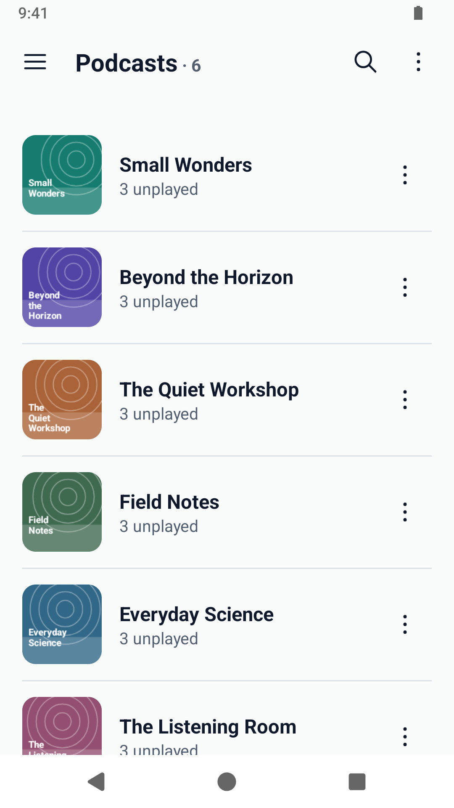
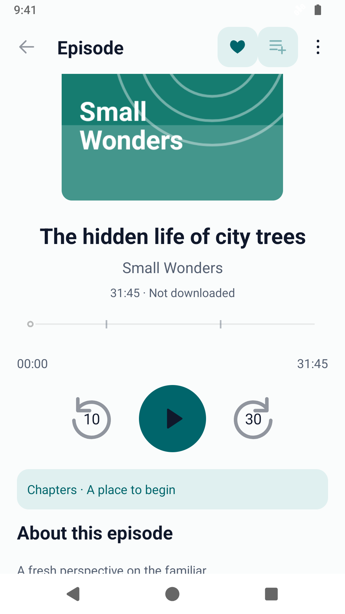
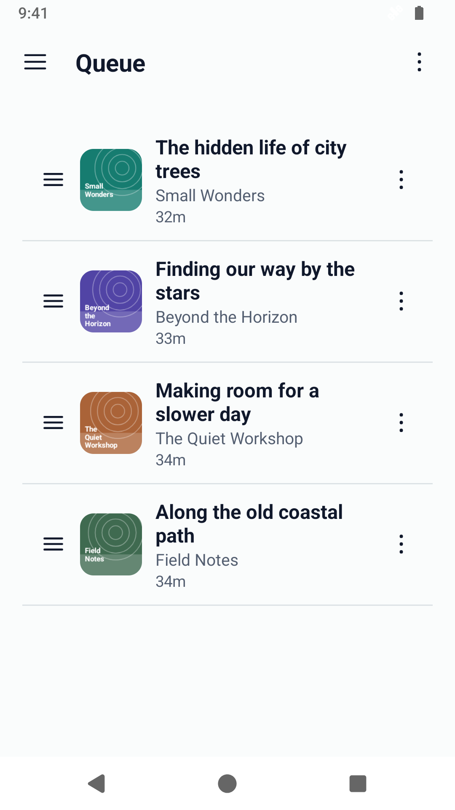

# PlainPodDroid

Podcasts, kept simple. Follow your shows, build a listening queue, stream episodes
or download them for later. PlainPodDroid works on Android 10 and newer, including
GrapheneOS, without Google Play Services.

## Make it your own

- Add a podcast with its RSS address or an Apple Podcasts link, or bring your
  subscriptions from another player with OPML.
- Browse new episodes, favorites, listening history and unfinished episodes.
- Queue episodes, set playback speed for each show, use chapters and a sleep
  timer, and choose your skip controls.
- Use the Download button beside Play to save an episode, or enable automatic
  downloads for a show. Set a storage budget and choose whether to remove
  completed downloads. Find requests and saved audio together in **Downloads**.
- Use a podcast’s menu to archive it while keeping local episodes and audio,
  subscribe again later, or delete it from your device.
- Choose **Download before playing** to download the complete episode when you
  press Play, then listen from the saved file.
- Set **Scheduled refresh and downloads** for selected days and a local start
  time, so new episodes can be ready before you leave.
- Switch on **Offline mode** to stop all app network activity. Your downloads,
  saved library and cached covers remain available.
- Choose a light or dark theme.

## A look around

| Podcasts | Episode and player | Queue |
|---|---|---|
|  |  |  |

Screenshots show the real app with fictional podcasts and original demonstration
artwork. See the [full screenshot set](docs/screenshots/README.md), including dark mode.

## Install and update

The first signed release is being prepared. Once it is available, download the
APK from [GitHub Releases](https://github.com/jnesew/PlainPodDroid/releases), or
[add PlainPodDroid to Obtainium](https://apps.obtainium.imranr.dev/redirect?r=obtainium://app/%7B%22id%22%3A%22io.github.jnesew.plainpoddroid%22%2C%22url%22%3A%22https%3A%2F%2Fgithub.com%2Fjnesew%2FPlainPodDroid%22%2C%22author%22%3A%22jnesew%22%2C%22name%22%3A%22PlainPodDroid%22%2C%22additionalSettings%22%3A%22%7B%5C%22includePrereleases%5C%22%3Afalse%2C%5C%22apkFilterRegEx%5C%22%3A%5C%22%5EPlainPodDroid-%5B0-9%5D%2B%5C%5C%5C%5C.%5B0-9%5D%2B%5C%5C%5C%5C.%5B0-9%5D%2B%5C%5C%5C%5C.apk%24%5C%22%2C%5C%22autoApkFilterByArch%5C%22%3Afalse%7D%22%7D) to follow stable releases.
You can also paste `https://github.com/jnesew/PlainPodDroid` into Obtainium.
One universal APK supports all compatible devices.

Release candidates use the separate [preview configuration](distribution/obtainium-preview.json).
Preview builds need Obtainium’s pre-release option; the normal configuration
follows stable releases. There is no updater inside the podcast player.

## Your library stays with you

You do not need an app account. Subscriptions, downloads and listening history
stay on your device, and the app has no advertising, analytics or crash reporting.
Podcast publishers may include ads in their own audio.

When online, the app connects to the hosts that provide your subscribed feeds,
cover art, chapters and audio. Previewing an Apple Podcasts link also contacts
Apple to find its RSS address. Offline mode stops these connections, including
background updates. OPML lets you move your subscriptions between players; keep
exports private if they contain private feed links. Exports do not include your
passwords, audio downloads or listening history.

## A few things to know

PlainPodDroid plays HTTPS audio podcasts. Some paid or platform-only shows do not
provide a usable RSS feed. Public RSS feeds and supported private feed links can
be added; feeds that require a login support HTTPS Basic authentication.

There is no podcast directory or cross-device sync. Use an RSS/Apple link from a
source you trust, or import your existing subscriptions.

## Help and source

Found a problem? [Open an issue](https://github.com/jnesew/PlainPodDroid/issues)
with your Android version, app version and the steps to reproduce it. Please
leave out private feed links, passwords and other personal information.

For security concerns, see [Security reporting](SECURITY.md).

For building from source, see [Building](docs/BUILDING.md).

## License

PlainPodDroid’s original code is available under the [MIT license](LICENSE).
See [third-party notices](THIRD_PARTY_NOTICES.md) for the libraries used by the
app. License texts are also available offline from About in the app.
